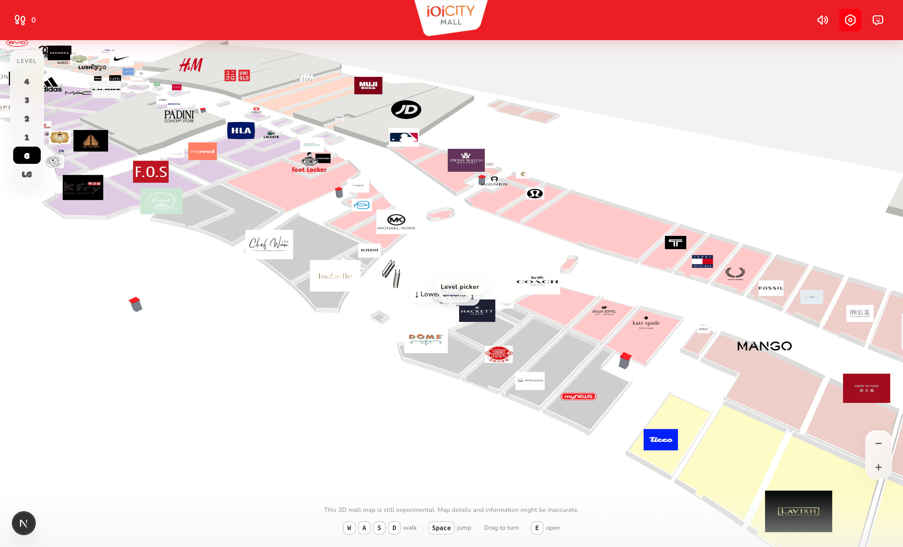

# IOI City Mall · 3D Directory

Walk around IOI City Mall, Putrajaya, in 3D. Find any shop, follow a route to it across all six levels, and see what's new, what's on offer and what's opening soon. The shop data refreshes itself from the mall's own directory every morning.

**Live:** [ioi-directory.vercel.app](https://ioi-directory.vercel.app)



> **Unofficial fan project.** Not affiliated with, endorsed by or connected to IOI City Mall, IOI Properties Group or any retailer shown. Trademarks and logos belong to their owners and are used for identification only. Shop details may be out of date, so check with the mall before you visit.

## What you can do

- **Walk the mall.** Every level from Lower Ground to Level 4, built from the mall's official wayfinding geometry, with shop logos floating above each unit and furnished interiors in each brand's colours.
- **Find a shop.** Search about 700 shops by name, unit or category, on this floor or the whole mall. Pick one and your character walks there along a red route line, riding escalators between levels when the shop is on another floor.
- **Ride escalators and lifts.** Walk up to an escalator bank or lift and choose up or down.
- **Open a shop's profile.** See its storefront photo, description, opening hours, phone, website and any current CLUB IOI offers.
- **See what's on.** The ✨ panel shows:
  - whether the mall is open right now (on Malaysia time)
  - shops that opened in the last 30 days
  - running offers
  - units that are coming soon
  - attractions such as District 21 and Icescape
  - shops that recently closed
- **Spot what's coming.** Units being fitted out stand behind hoarding with a "COMING SOON" sign in 3D, and are badged in the directory.

### Controls

| Key | Action |
| --- | --- |
| `W` `A` `S` `D` | Walk |
| `Shift` | Run |
| `Space` | Jump |
| Drag | Turn the camera |
| `E` | Open the shop you're standing at |
| `/` | Find a shop |
| `R` / `F` | Go up / down at an escalator or lift |

On phones, use the on-screen joystick and tap shops directly.

## How the data stays fresh

The mall publishes its directory through Abuzz, the wayfinding system behind its own map. Every day at 06:00 Malaysia time, the **Sync IOI directory** GitHub Action:

1. Checks the mall's release number and stops if nothing changed.
2. Downloads the new directory and map geometry, then rebuilds:
   - shop logos and storefront photos (removing those of shops that left)
   - the floor plans
   - the directory
   - offers and opening hours
   - brand colours
3. Records what changed (new, opened, coming soon, moved, renamed and closed shops) for the What's on panel.
4. Runs lint, type check and a production build, then opens a PR listing the changes.
5. Merges it automatically, which redeploys the site on Vercel.

   Releases that look wrong stay open as `needs-review` PRs instead of merging. That covers three cases: many shops vanishing, the directory shrinking sharply, or levels going missing.

To run it by hand:

```bash
npm run ioi:sync            # does nothing if the mall hasn't published a new release
npm run ioi:sync -- --force # rebuild anyway
```

The sync needs Python 3 with Pillow (`pip install pillow`) for the image steps.

## Running it locally

Requires Node.js 24 or newer.

```bash
npm install
npm run dev        # http://localhost:3000
```

| Command | What it does |
| --- | --- |
| `npm run dev` | Start the dev server |
| `npm run build` | Production build |
| `npm run check` | Lint, type check and build: what CI runs |
| `npm run ioi:sync` | Pull the mall's latest directory |

## How it's built

- **Next.js 16** (App Router, React 19, TypeScript strict) and **Tailwind CSS v4**
- **React Three Fiber** + **drei** for the 3D world: floors, walls, escalators, logos, interiors and the walking character
- **Vercel** for hosting, with **GitHub Actions** for CI and the daily directory sync

```
src/
  app/                  # The page, manifest and styles
  components/           # Header, directory, What's on, shop profile, overlays
    world/              # 3D scene: floors, escalators, player, logos, interiors, route line
  data/                 # Generated by the sync: floor plans, directory, offers, update history
  lib/                  # Mall geometry, pathfinding, opening hours and offers
scripts/
  ioi-sync-abuzz.mjs    # Daily sync entry point
  ioi-build-from-abuzz.mjs, ioi-fetch-media.py, ioi-brand-colors.py
docs/research/ioi/      # Source data and research notes
.github/workflows/      # CI and the daily sync
```

## Credits

- Shop directory, map geometry, logos and offers: IOI City Mall's public directory (Abuzz).
- Music: "Bossa Antigua" by Kevin MacLeod ([incompetech.com](https://incompetech.com)), licensed under [Creative Commons: By Attribution 4.0](https://creativecommons.org/licenses/by/4.0/).
- Started from [JCodesMore's AI Website Cloner Template](https://github.com/JCodesMore/ai-website-cloner-template) (MIT, see [LICENSE](LICENSE)).
